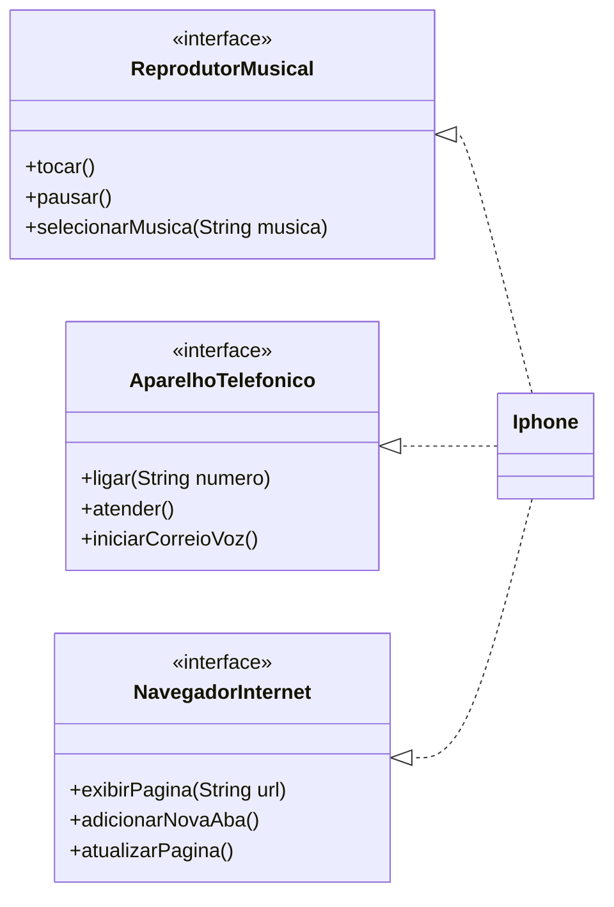

# iPhone UML

Exercício do bootcamp de Java da DIO: modelar um iPhone em UML e depois escrever as classes em Java. O iPhone junta três aparelhos, e cada um virou uma interface que a classe `Iphone` implementa.

O código está em `iphone-uml/src`. As interfaces têm os métodos acima, e o `Iphone` implementa todos. O `App.java` ainda é só o "Hello, World" gerado pelo VS Code, então não há nada para rodar além disso.
